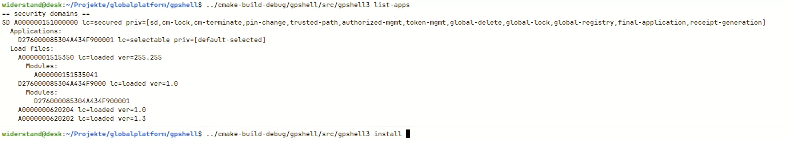

# Summary

GPShell (GlobalPlatform Shell) is a script interpreter which talks to a smart card.  It is written on top of the GlobalPlatform library.
It uses smart card communication protocols ISO-7816-4 and OpenPlatform 2.0.1 and GlobalPlatform 2.1.1 and later.
It can establish a secure channel with a smart card, load, instantiate, delete, list applications and manage keys on a smart card.

GPShell is licensed under GPL-3.0-or-later. Its distributed license notice and
source files include the OpenSSL linking exception used for the release builds.

__!!!!!!!!!!!!!!!!!!!!!!!!!!!!!!!!!!!__

__PLEASE OBEY THAT EVERY CARD GETS LOCKED AFTER A FEW (USUALLY 10) UNSUCCESSFUL MUTUAL AUTHENTICATIONS.
THE CONTENTS OF A LOCKED CARD CANNOT BE MANAGED ANYMORE (DELETED, INSTALLED)!!!
IF YOU EXPERIENCE SOME UNSUCCESSFUL MUTUAL AUTHENTICATION ATTEMPTS FIRST EXECUTE A SUCCESSFUL MUTUAL AUTHENTICATION WITH A KNOWN WORKING PROGRAM
TO RESET THE RETRY COUNTER BEFORE YOU PROCEED WITH GPSHELL. CHECK THE PARAMETERS FOR MUTUAL AUTHENTICATION (KEYS, SECURITY PROTOCOL) AND ASK IF ANYBODY KNOWS IF THE CARD IS SUPPORTED.__

__!!!!!!!!!!!!!!!!!!!!!!!!!!!!!!!!!!!__

# Pre-build Packages

Prebuild packages for Windows are provided in the [release page](https://github.com/kaoh/globalplatform/releases) as MSI, MSIX and ZIP.

Prebuild packages for Linux are provided in the [release page](https://github.com/kaoh/globalplatform/releases) as DEB, RPM and AppImage.

Prebuild packages for macOS are provided in the [release page](https://github.com/kaoh/globalplatform/releases) as DMG.

There are Homebrew packages for [Linux and macOS](https://github.com/kaoh/homebrew-globalplatform).

# Execution

There are 2 versions of GPShell. The new GPShell 3+, using a concise, task-oriented command line, 
and the older GPShell 1+ using script files chaining multiple commands into one session.

__NOTE:__ You also need at least one connection plugin, e.g., the shipped `gppcscconnectionplugin` to use PC/SC, which is bundled by default, so there is no need to worry.
However, it is possible to implement a different communication channel, e.g., tunneling over TCP/IP.
Existing solution like [pcsc-relay](https://frankmorgner.github.io/vsmartcard/pcsc-relay/README.html) might be a quicker solution.

## GPShell 3+

Several quick demo videos showcasing the most useful features in action:

[](https://youtu.be/MtZoTkrB41I)

Other advanced features:

* [Delegated Management and Receipts with ECC](https://youtu.be/jnyjurH8yyE)
* [Security Domain Management](https://www.youtube.com/watch?v=SSFotz3p30k)
* [DAP Functionality](https://youtu.be/WhlAlZTJ_5c)
* [Card Data](https://youtu.be/IcLAxSBznfM)

### Command Line Documentation

Read the [GPShell3 man page](./src/gpshell3.1.md) for all commands and their options or use `man gpshell3` under Linux or macOS.

### Example Script Files

In the [examples directory](./examples) of this project:

- [examples/gpshell3](./examples/gpshell3) contains GPShell3 `.sh` examples.

After installation these examples can be found under:

- `/usr/share/doc/gpshell3/examples/`
- `/usr/local/share/doc/gpshell3/examples/`
- `/home/linuxbrew/.linuxbrew/share/doc/gpshell3/examples/`

### Architecture & Design

`gpshell3` uses a modular architecture separating CLI option parsing, central command registration with dynamic JSON schemas, reusable execution handlers, secure card session lifecycle management, and a dual-mode output/error subsystem supporting both human-readable console text and structured JSON (as well as native Model Context Protocol JSON-RPC 2.0 communication).

```mermaid
graph TD
    Client["AI Assistant / IDE / CLI / CI"] -->|JSON-RPC 2.0 (STDIO) or CLI args| Main["gpshell3 (gpshell3.c)"]
    Main -->|--mcp| MCP["MCP Server (gpshell3_mcp.c)"]
    Main -->|CLI Command| Reg["Command Registry (gpshell3_registry.c)"]
    MCP -->|Query Schemas & Tools| Reg
    MCP -->|tools/call & Elicitation| Reg
    Reg -->|Execute Command| Cmd["Command Handlers (gpshell3_commands.c)"]
    Cmd -->|Card Connection & Auth| Sess["Session Manager (gpshell3_session.c)"]
    Sess -->|PC/SC & APDUs| GP["libglobalplatform & PC/SC Plugin"]
    Cmd -->|Format Text / JSON| Out["Output & Error Engine (gpshell3_output.c)"]
    Out -->|cJSON AST| JSON["JSON / JSON-RPC Response"]
    Out -->|stdout / stderr| Text["Console Text Output"]
```

#### Module Responsibilities

| File | Responsibilities / Purpose |
|---|---|
| `gpshell3.c` | CLI entry point. Parses global command-line options (`--output`, `--mcp`, `--reader`, `--sd`, `--sec`, keys), initializes registry/session, and routes execution to CLI command handlers or starts the MCP STDIO server. |
| `gpshell3_registry.h`, `gpshell3_registry.c` | Central Command Registry. Serves as single source of truth for command metadata, CLI option mapping, MCP tool naming (`gpshell3_<cmd>`), JSON input/output schemas for LLMs, and risk level (`is_destructive`, `requires_session`). |
| `gpshell3_commands.h`, `gpshell3_commands.c` | Reusable command execution logic for all 45 smart card and offline operations (query, mutation, key management, receipt/token verification), supporting both CLI argument lists and structured cJSON arguments. |
| `gpshell3_session.h`, `gpshell3_session.c` | Smart card session controller. Encapsulates PC/SC connection handles, ISD selection, mutual authentication (SCP01, SCP02, SCP03, SCP11), explicit MCP session tokens (`session_id`), and cryptographic memory zeroization upon close. |
| `gpshell3_output.h`, `gpshell3_output.c` | Generic dual-format presentation & error reporting engine. Emits formatted text in default CLI mode or structured JSON envelopes in `--output json` and MCP modes (`gpshell3_output_ctx_t`, `gpshell3_report_error`, `gpshell3_report_opgp_error`). |
| `gpshell3_mcp.h`, `gpshell3_mcp.c` | Native Model Context Protocol (MCP) JSON-RPC 2.0 server over STDIO. Handles `initialize`, `ping`, `tools/list`, `tools/call`, mutation safety checks (MCP Elicitation), and sensitive credential redaction. |
| `cJSON.h`, `cJSON.c` | Embedded, zero-dependency ANSI C JSON parser and AST serializer. |
| `gpshell3.1.md` | Comprehensive user manual and man page documentation for `gpshell3`. |

### Model Context Protocol (MCP) Integration

`gpshell3` includes an embedded Model Context Protocol (MCP) STDIO server (`gpshell3 --mcp`) communicating over JSON-RPC 2.0. This allows AI assistants and IDEs to discover and invoke all smart card commands as typed tools with validation schemas.

#### Standard JSON Configuration (VS Code, Cursor, JetBrains IDEs)

IDEs and extensions supporting standard `mcpServers` JSON configuration (e.g., `.idea/mcp.json`, `.vscode/mcp.json`, `.cursor/mcp.json`, or `cline_mcp_settings.json`) use:

```json
{
  "mcpServers": {
    "gpshell3": {
      "command": "gpshell3",
      "args": ["--mcp"]
    }
  }
}
```

On Windows (if `gpshell3` is not in `PATH`):

```json
{
  "mcpServers": {
    "gpshell3": {
      "command": "C:\\Program Files\\GlobalPlatform\\gpshell3.exe",
      "args": ["--mcp"]
    }
  }
}
```

#### Claude Desktop

Add the `mcpServers` configuration to `claude_desktop_config.json`:
- **macOS**: `~/Library/Application Support/Claude/claude_desktop_config.json`
- **Windows**: `%APPDATA%\Claude\claude_desktop_config.json`
- **Linux**: `~/.config/Claude/claude_desktop_config.json`

#### Claude Code CLI

For Claude Code CLI (`claude`), add `gpshell3` via the `claude mcp add` command:

```sh
claude mcp add gpshell3 -- gpshell3 --mcp
```

Or for global user scope:

```sh
claude mcp add --scope user gpshell3 -- gpshell3 --mcp
```

#### JetBrains IDEs (IntelliJ IDEA / CLion) via UI

1. Go to **Settings / Preferences** (`Ctrl+Alt+S` or `Cmd+,`) → **Tools** → **Model Context Protocol (MCP)** or **AI Assistant** → **MCP Servers**.
2. Click **+** (**Add Server**) → choose **Command** (STDIO):
   - **Name**: `gpshell3`
   - **Command**: `gpshell3` (or full binary path, e.g. `/usr/local/bin/gpshell3` or `C:\Program Files\GlobalPlatform\gpshell3.exe`)
   - **Arguments**: `--mcp`
3. Save and apply. The IDE connects and exposes all `gpshell3_*` tools to the AI Assistant.

#### Codex CLI

For OpenAI Codex CLI, add `gpshell3` via the `codex mcp add` command:

```sh
codex mcp add gpshell3 -- gpshell3 --mcp
```

Or configure in `~/.codex/config.toml` (or project `.codex/config.toml`):

```toml
[mcp_servers.gpshell3]
command = "gpshell3"
args = ["--mcp"]
```

#### OpenCode CLI

For OpenCode CLI (`opencode`), add `gpshell3` via the `opencode mcp add` command:

```sh
opencode mcp add gpshell3 --global -- gpshell3 --mcp
```

> **Note**: For standard installations (Homebrew, Linux packages, Windows installers), the PC/SC connection plugin and libraries are bundled and detected automatically without requiring extra environment variables (`OPGP_PLUGIN_PATH` or `DYLD_LIBRARY_PATH`).

#### Persistent AI Agent Preferences & Configuration

When configuring AI coding assistants (such as OpenAI Codex, Claude Code, OpenCode, Cursor, Windsurf, GitHub Copilot, or JetBrains Junie) to interact with smart cards, add the following instruction snippet to your project's `AGENTS.md`, `~/.codex/AGENTS.md`, `CLAUDE.md`, `.cursorrules`, `.github/copilot-instructions.md`, or the assistant's instructions:

```text
For smart-card, GlobalPlatform, gpshell, or gpshell3 tasks, discover
and prefer the gpshell3 MCP tools before invoking CLI commands. For
application enumeration, open an unauthenticated session and use
gpshell3_list_apps.

Start reader discovery with gpshell3_list_readers or inspect the card
with gpshell3_inspect_card. Prefer gpshell3 MCP tools over opensc-tool,
gp, gpshell, pcsc_scan, or custom APDU scripts. Use shell fallbacks
only when the relevant MCP capability is unavailable or insufficient.

Authentication errors are not evidence that the MCP server is
unavailable. Never guess card keys. An established session persists
across commands; if status word 6982 (AUTHENTICATION_REQUIRED) occurs
after lifecycle changes, re-authenticate via gpshell3_open_session.
```

**Key Agent Rules & Best Practices**:
- **Tool Prioritization**: Always prefer embedded `gpshell3` MCP tools over external CLI tools (`opensc-tool`, `gp`, `gpshell`, `pcsc_scan`, or raw APDU scripts).
- **Discovery**: Start with `gpshell3_list_readers` or zero-friction `gpshell3_inspect_card` to discover connected card readers and inspect unauthenticated hardware/applet state.
- **Session Lifecycle**: Use `gpshell3_open_session` as the prerequisite tool to establish a smart card session (unauthenticated by default when called with `{}`, or authenticated when `authentication` keys are provided) for card management operations (`gpshell3_list_apps`, `gpshell3_install`, `gpshell3_delete`, `gpshell3_put_key`), and close the session with `gpshell3_close_session`.
- **Structured Error Handling**: Pay attention to returned ISO status words (e.g., SW `6982` / `AUTHENTICATION_REQUIRED`). Missing authentication indicates that key-based authentication is required, not that the MCP server or card reader failed; never guess authentication keys. If card state resets after lifecycle changes (such as package deletion), re-authenticate with `gpshell3_open_session`.

#### Safe Session & Elicitation Workflow

- **Explicit Session Management**: `gpshell3_open_session` initiates PC/SC communication and optional mutual authentication (SCP01, SCP02, SCP03, SCP11), returning an opaque `session_id`. `gpshell3_close_session` closes the channel and zeroizes keys in memory.
- **Destructive Mutation Protection**: State-modifying operations (`install`, `delete`, `put-key`, `update-registry`, `apdu`, etc.) require explicit human confirmation via MCP Elicitation before touching the card.
- **Sensitive Data Redaction**: Cryptographic keys and PINs are never leaked into tool outputs, error responses, or logs.

### MacOS

For macOS you might set:

      export DYLD_LIBRARY_PATH=/opt/local/lib

so that all necessary libraries are found.

## GPShell 1+

### Command Line Documentation

Read the [GPShell1 man page](./src/gpshell.1.md) for all commands and their options or use `man gpshell` under Linux or macOS.

### Example Script Files

In the [examples directory](./examples) of this project:

- [examples/gpshell](./examples/gpshell) contains legacy GPShell1 `.txt` script examples.

After installation these examples can be found under:

- `/usr/share/doc/gpshell3/examples/`
- `/usr/local/share/doc/gpshell3/examples/`
- `/home/linuxbrew/.linuxbrew/share/doc/gpshell3/examples/`
- 
### macOS

For macOS you might set:

      export DYLD_LIBRARY_PATH=/opt/local/lib

so that all necessary libraries are found.

# Compilation

For further detailed instructions also consult the `README.md` from the `globalplatform` sub project.

## Prerequisites

Use a suitable packet manager for your OS or install the programs and libraries manually if applicable.

* Compiler Suite:
  * Linux: Termed `build-essential` in Debian based distributions (gcc, make)
  * MacOS: Xcode
  * Windows: Visual Studio and SDK
* [CMake 3.10](http://www.cmake.org/) or higher is needed
* [PC/SC Lite](https://pcsclite.apdu.fr) (only for UNIXes, Windows and MacOS is already including this)
* [zlib](http://www.zlib.net/) (MacOS should already bundle this, for Windows a pre-built version is included)
* [GlobalPlatform](https://github.com/kaoh/globalplatform)

## Unix/MacOS

On a command line type:

```
cd \path\to\globalplatform
cmake .
make
make install
```

## Windows

Launch Visual Studio Command Prompt / Developer Command Prompt / Developer PowerShell:

```
cd \path\to\globalplatform
cmake -G "NMake Makefiles"  
nmake
```

## Source Packages

Execute:

    make/nmake package_source

## Binary Packages

Execute:

    make/nmake package

## Debug Builds

To be able to debug the library enable the debug symbols:

cmake -DDEBUG=ON


## Man Page (Only for UNIXes)

The man page is translated with [pandoc](https://pandoc.org) from markdown to groff syntax. To render a preview of the result use:

~~~shell
cd src
pandoc --standalone --to man gpshell.1.md | groff -man -Tascii
pandoc --standalone --to man gpshell3.1.md | groff -man -Tascii
~~~

## Debug Output

If you experience problems a DEBUG output is helpful.
The variable `GLOBALPLATFORM_DEBUG=1` in the environment must be set. The log file can be set with `GLOBALPLATFORM_LOGFILE=<file>`. Under Windows by default `C:\Temp\GlobalPlatform.log` is chosen. The log file must be writeable for the user.
Under Unix systems if syslog is available it will be used by default.
 The default log file under Unix systems is `/tmp/GlobalPlatform.log` if syslog is not available or cannot be written by the user. If you don't have access to the syslog or don't want to use it you can still set the
`GLOBALPLATFORM_LOGFILE` manually. Keep in mind that the debugging output may contain sensitive information, e.g. keys!
